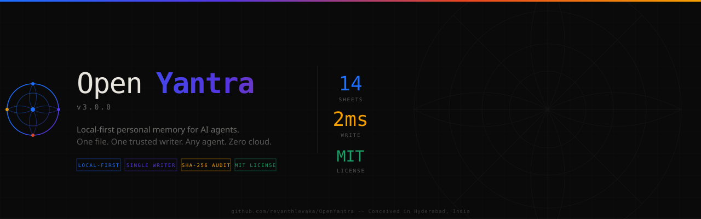
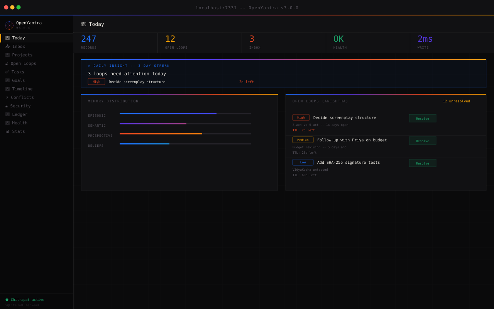
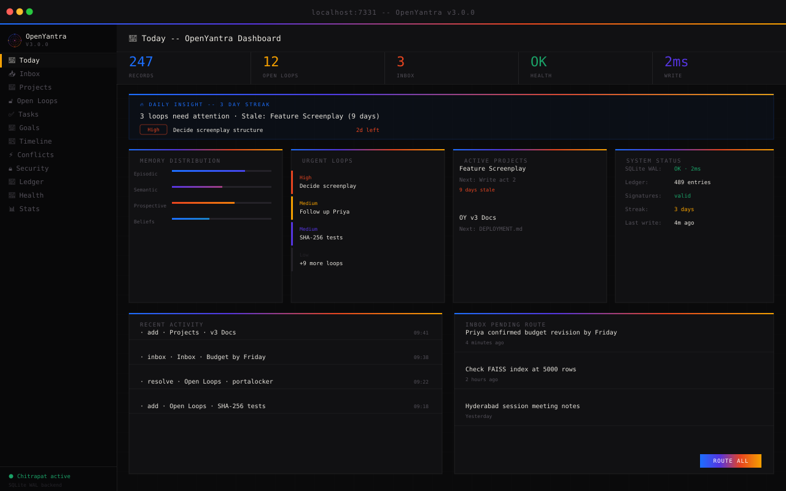
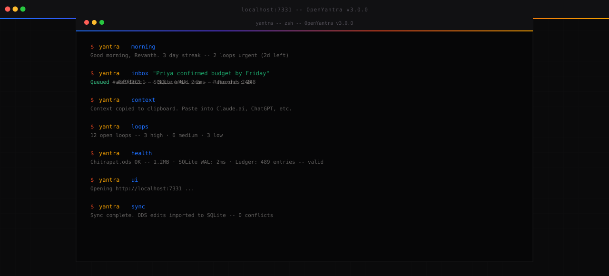
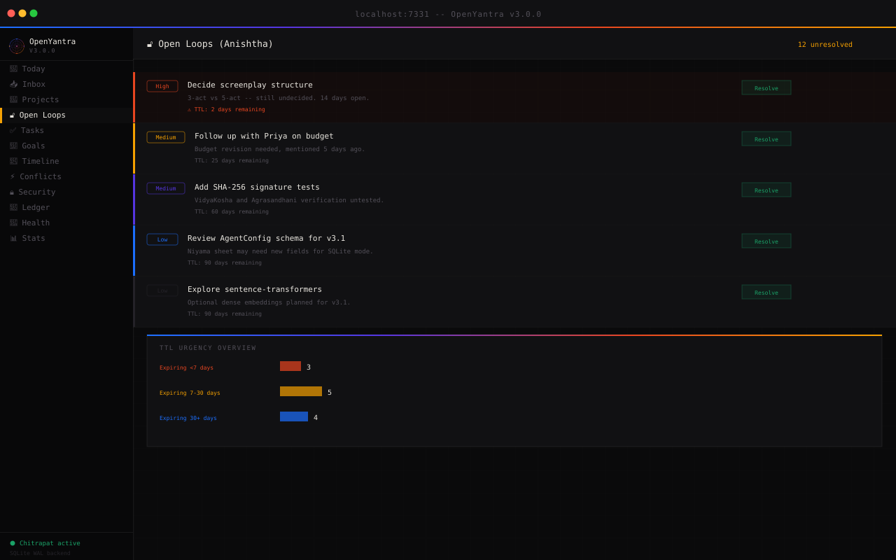

<p align="center">
  
</p>

<h1 align="center">OpenYantra</h1>
<h3 align="center">The Sacred Memory Machine</h3>
<h4 align="center"><em>यन्त्र -- Inspired by Chitragupta, the Hindu God of Data</em></h4>

<p align="center">
  <a href="https://github.com/revanthlevaka/OpenYantra/actions/workflows/ci.yml"></a>
  
  
  
  
  
  
</p>

<p align="center">
  <strong>Your personal AI agents remember nothing between sessions. OpenYantra fixes that permanently.</strong><br/>
  One open-standard file. Zero cloud lock-in. Omnipresent Desktop HUD. 1-Click MCP. Local AI sleep consolidation.
</p>

---

<p align="center">
  
</p>

<p align="center">
  
  <br/>
  <em>Capture decisions in Cursor (<code>Cmd+Shift+Y</code>) & git commits → Instant recall in fresh Claude Desktop sessions with strict workspace isolation.</em>
</p>

---

## The Problem -- Why Your AI Forgets (Session Amnesia)

Every time you open a fresh window in **Claude Desktop**, **Cursor**, **ChatGPT**, or terminal coding agents, they wake up with complete amnesia. They don't know yesterday's architecture decisions, active project milestones, or what you were debugging before you shut your laptop. You waste time re-explaining your stack and re-prompting every single day.

When conversation context windows fill up, the AI quietly compresses older messages -- and your active context vanishes mid-task.

### How OpenYantra Compares

Developers often try two extremes: hand-curating a `NOTES.md` file or piping everything to a hosted vector cloud. Here is why both fall short:

| Capability | Hand-Kept `NOTES.md` | Cloud Vector DB (Pinecone / MemGPT SaaS) | **OpenYantra** |
| :--- | :--- | :--- | :--- |
| **Multi-Tool Sync** | ❌ Manual copy-paste; cannot live-sync across Claude Desktop & Cursor simultaneously | ⚠️ Requires proprietary API keys, network latency, and per-tool plugins | ✅ **Zero-effort live sync**: Desktop HUD (`Cmd+Shift+Y`), CLI, and MCP share the exact same local SQLite WAL |
| **Revert / Undo Awareness** | ❌ Static notes ignore git history; stale decisions linger indefinitely | ❌ High risk of context regression (old vector matches resurrect discarded choices) | ✅ **Git Revert Tracking**: Commit reverts automatically tag decisions `[REVERTED / SUPERSEDED]`; Nidra excludes them from beliefs |
| **Secret & Key Safety** | ❌ High risk of committing API tokens into plaintext notes | ❌ API keys and private code snippets stream to third-party cloud servers | ✅ **Raksha Redactor**: Pattern-matches and sanitizes OpenAI, Anthropic, AWS, GitHub tokens before saving |
| **Storage & Data Ownership**| ✅ Local plain text | ❌ Cloud lock-in, recurring monthly SaaS fees, opaque embeddings | ✅ **100% Open & Local**: Standard `.ods` (LibreOffice ISO/IEC 26300), `.sqlite`, and `.md` |
| **Capture Friction** | ❌ High friction -- requires manually switching tabs and updating files | ⚠️ Agent-dependent; no universal OS hotkey | ✅ **Frictionless**: Global hotkey HUD (`Cmd+Shift+Y`), Git post-commit hooks, and MCP tools |
| **Consolidation & Pruning** | ❌ Notes file grows uncontrollably into unreadable clutter | ⚠️ Blind similarity search returns contradictory chunks | ✅ **Nidra Sleep Engine**: Clusters daily sessions, closes open loops, and promotes recurring preferences |

> **💡 Does the Desktop HUD write to the same store the MCP server reads?**  
> **Yes, 100%.** Both the native Desktop HUD (`Cmd+Shift+Y`), the terminal CLI, and the Cognitive MCP Server (serving Cursor & Claude Desktop) connect directly to the same local SQLite database in WAL (Write-Ahead Logging) mode. When you capture a thought or task in the HUD, your next prompt in Cursor or Claude instantly sees it with sub-millisecond read latency.

---

## ⚡ What's New in v6.1 ("Akasha & Sutra") & Desktop v1.0

### 1. 🖥️ OpenYantra Desktop & Floating HUD (`Cmd+Shift+Y`)
No more opening browser tabs. Run `yantra desktop` (or `yantra hud`) to launch an ultra-lightweight native OS HUD (< 15MB binary, zero Electron bloat). Press `Cmd+Shift+Y` to trigger a Raycast/Spotlight-style floating palette directly over Cursor, VS Code, or your terminal.
- **Instant Capture:** Quick-dump notes with `#project`, `@person`, or `!urgent` tags.
- **Instant Recall:** Live fuzzy & semantic search across your entire knowledge base.
- **1-Click Sleep:** Trigger autonomous memory consolidation right from the HUD.

### 2. ⚡ 1-Click MCP Auto-Setup for Claude & Cursor (`yantra mcp setup`)
Zero manual JSON editing. One command auto-detects Claude Desktop and Cursor configurations across macOS, Windows, and Linux, creates a backup, and installs the OpenYantra MCP server seamlessly.

### 3. 🌙 Autonomous Sleep & Memory Consolidation (Nidra)
Mimics biological slow-wave sleep. Run `yantra dream` or `yantra consolidate`:
- **Episodic Clustering:** Clusters recent session logs into macro-milestones and decisions.
- **Open Loop Auto-Resolution:** Automatically identifies and closes loops resolved during work.
- **Preference Promotion:** Promotes recurring user preferences (e.g., *"prefers dark mode"*, *"always use python 3.9"*) into foundational `Beliefs & Principles`.
- **Local Ollama Integration:** Connects to local Ollama (`llama3`, `mistral`, `phi3`) with automatic fallback to deterministic heuristics. Zero cloud dependency.

### 4. 📓 Bi-Directional Obsidian Vault Sync (`yantra vault sync`)
- **Export:** Translates your Chitrapat into clean Obsidian Markdown notes with YAML frontmatter, wikilinks (`[[Projects/X]]`), and task checklists.
- **Import:** Check off an item (`- [x]`) in Obsidian, and OpenYantra resolves it in the ledger. Add notes in `Inbox.md`, and they are enqueued into your memory bank.

### 5. 🛡️ Raksha Credential & Secret Redactor Guard
Pre-commit interceptor pattern-matches and redacts Anthropic, OpenAI, AWS, GitHub, Google API keys, Slack tokens, and private keys before committing any record to disk.

### 6. 🐙 Git Commit Auto-Ingest & Revert Detection (`yantra hook install`)
Install a git post-commit hook in your repositories. Every time you commit code, OpenYantra automatically extracts the commit hash, branch, message, and modified files into your `Session Log`. If you revert a commit (`git revert`), OpenYantra automatically detects the rollback, tags the prior decision as `[REVERTED / SUPERSEDED]`, and ensures the Nidra sleep engine never promotes undone code experiments into your core architecture beliefs.

### 7. 📟 Cyberpunk Terminal TUI (`yantra tui`)
For command-line purists and SSH workflows. An interactive terminal dashboard displaying live open loops, active projects, recent decisions, and quick-capture hotkeys.

### 8. 🔌 Drop-in Framework Adapters
First-class Python bindings for:
- **LangChain:** `OpenYantraChatMessageHistory`, `OpenYantraRetriever`
- **CrewAI:** `OpenYantraCrewMemory` for multi-agent autonomous teams

---

## 🚀 Install in One Command

### macOS / Linux:
```bash
curl -sSL https://raw.githubusercontent.com/revanthlevaka/OpenYantra/main/install.sh | bash
```

### Windows (PowerShell):
```powershell
irm https://raw.githubusercontent.com/revanthlevaka/OpenYantra/main/install.ps1 | iex
```

### Python Package (Pip):
```bash
git clone https://github.com/revanthlevaka/OpenYantra.git
cd OpenYantra
pip install -e ".[full]"
```

---

## 🛠️ Quickstart Workflow

```bash
# 1. Initialize your personal memory vault (12-question bootstrap interview)
yantra bootstrap

# 2. Configure Claude Desktop & Cursor with 1 click
yantra mcp setup

# 3. Launch the native Desktop HUD (or press Cmd+Shift+Y)
yantra desktop

# 4. View your Morning Brief in the terminal
yantra morning

# 5. Quick capture thoughts, tasks, or loops
yantra inbox "Follow up with Priya regarding the distributed consensus paper"

# 6. Run autonomous sleep consolidation at the end of the day
yantra dream

# 7. Sync with your Obsidian Vault
yantra vault sync ~/my_vault

# 8. Launch the Cyberpunk Terminal TUI
yantra tui
```

---

## 🧭 CLI Command Cheatsheet

| Command | Action |
| :--- | :--- |
| `yantra bootstrap` | Interactive 12-question interview to build your Chitrapat vault |
| `yantra desktop` | Launch native Desktop App & floating HUD palette (`yantra app` / `yantra hud`) |
| `yantra tui` | Open interactive Cyberpunk Terminal TUI |
| `yantra mcp setup` | Auto-configure Claude Desktop and Cursor MCP settings |
| `yantra mcp serve` | Run the standard MCP JSON-RPC server on stdin/stdout |
| `yantra dream` | Run autonomous Nidra memory consolidation (`yantra consolidate`) |
| `yantra vault sync [dir]`| Bi-directional sync with Obsidian Markdown vault (`export` / `import`) |
| `yantra hook install` | Install Git post-commit auto-ingest hook in current repo |
| `yantra morning` | Display your daily briefing, streak, and active open loops |
| `yantra context` | Compile dynamic context and copy Markdown to clipboard |
| `yantra loops` | List and filter unresolved open loops |
| `yantra health` | Run complete database integrity and health diagnostics |
| `yantra doctor` | Verify system environment, SQLite WAL, and vector embedders |
| `yantra ui [--port 7331]` | Launch the browser-based executive memory dashboard |

---

## 🏛️ System Architecture

```
┌────────────────────────────────────────────────────────────────────────┐
│                        OPENYANTRA UNIFIED ARCHITECTURE                 │
└────────────────────────────────────────────────────────────────────────┘

  [Omnipresent Inputs]
    ├── Desktop HUD (Cmd+Shift+Y)  ────► [FastAPI Local REST Engine]
    ├── System Tray Daemon         ────► [Port 7331 / Unix Socket]
    ├── Git Post-Commit Hook       ────►          │
    ├── CLI & Cyberpunk TUI        ────►          │
    └── IDE / Cursor MCP Client    ────► [Cognitive MCP JSON-RPC]
                                                  │
                                                  ▼
                                     ┌─────────────────────────┐
                                     │  Raksha Redactor Guard  │ (Sanitizes keys & secrets)
                                     └────────────┬────────────┘
                                                  │
                                                  ▼
                                     ┌─────────────────────────┐
                                     │ Chitragupta SyncEngine  │ (Single-writer coordinator)
                                     └────────────┬────────────┘
                                                  │
                  ┌───────────────────────────────┴──────────────────────────────┐
                  ▼                                                              ▼
        [SQLite WAL Engine]                                            [Canonical Life Scroll]
       • < 2ms write latency                                          • `chitrapat.ods`
       • Sutradhar Graph Edges                                        • ISO/IEC 26300 Open Document
       • VidyaKosha Vector Index                                      • LibreOffice Human-Readable
                  │                                                              │
                  ▼                                                              ▼
       [Nidra Sleep Engine]                                           [Obsidian Vault Sync]
       • Episodic log clustering                                      • Markdown with YAML frontmatter
       • Open Loop auto-pruning                                       • Checkbox bidirectional resolution
       • Preference to belief promotion                               • Wikilinks [[Projects/X]]
```

---

## 📜 The 14 Sacred Memory Sheets

OpenYantra stores your life context across 14 dedicated sheets in `chitrapat.ods`:

| Sheet | Sanskrit | What it Stores |
|---|---|---|
| 👤 Identity | Svarupa | Persona, occupation, communication style, location |
| 🎯 Goals | Sankalpa | Long and short-term aims with success metrics |
| 🚀 Projects | Karma | Active work -- domain, status, next concrete step |
| 👥 People | Sambandha | Collaborators, relationship context, open threads |
| 💡 Preferences | Ruchi | Tools, habits, rules, anti-goals |
| 🧠 Beliefs | Vishwas | Values, worldview, epistemic evolution history |
| ✅ Tasks | Kartavya | Action items linked to projects with priorities |
| 🔓 Open Loops ★ | Anishtha | Unresolved threads (Zeigarnik Effect safety net) |
| 📅 Session Log | Dinacharya | Chronological episodic summaries & git commits |
| ⚙️ Agent Config | Niyama | Per-agent behavioral guidelines and trust tiers |
| 📒 Agrasandhanī | -- | Immutable ledger -- every write SHA-256 signed |
| 📥 Inbox | Avagraha | Quick capture dumping ground -- routed later |
| ✏️ Corrections | Sanshodhan | Agent-proposed edits pending human approval |
| 🔒 Quarantine | Nirodh | Blocked prompt injections and quarantined inputs |

---

## 🧪 Verification & Test Suite

OpenYantra maintains a rigorous test suite covering security, vector search, passkey authentication, MCP configuration, Nidra consolidation, and desktop HUD endpoints:

```bash
pytest tests/
```
```
============================= test session starts ==============================
platform darwin -- Python 3.9.6, pytest-8.4.2, pluggy-1.6.0
rootdir: /Users/revanthlevaka/openyantra
configfile: pyproject.toml

tests/test_adapters.py ...                                               [  4%]
tests/test_bootstrap.py ...                                              [  8%]
tests/test_cognitive.py .......                                          [ 19%]
tests/test_desktop.py ..                                                 [ 22%]
tests/test_git_hook.py ...                                               [ 26%]
tests/test_mcp_setup.py ...                                              [ 30%]
tests/test_nidra.py ....                                                 [ 36%]
tests/test_passkey.py .....                                              [ 44%]
tests/test_security_sanitizer.py ......                                  [ 52%]
tests/test_setu.py ....                                                  [ 58%]
tests/test_sutra.py ....                                                 [ 64%]
tests/test_sutradhar.py ...............                                  [ 86%]
tests/test_tui.py .                                                      [ 88%]
tests/test_ui_api.py .....                                               [ 95%]
tests/test_vault.py ...                                                  [100%]

================== 68 passed, 4 warnings in 96.69s (0:01:36) ===================
```

---

## 📸 Screenshots & Visual Experience

| Today Command Centre | Live Web Dashboard |
|:---:|:---:|
|  |  |

| Terminal Cyberpunk TUI | Open Loops (Anishtha) |
|:---:|:---:|
|  |  |

---

## ⚖️ How OpenYantra Compares

| Dimension / Capability | Living Brain (`livingbrain.com`) | Mem0 / Zep | **OpenYantra (v6.2)** |
| :--- | :---: | :---: | :---: |
| **Hosting Model** | Proprietary Cloud SaaS | Cloud SaaS / Complex Self-Host | **100% Local-First / Zero Cloud** |
| **Data Sovereignty & Privacy** | Third-party cloud servers | Third-party cloud servers | **Your device only (Offline SQLite & ODS)** |
| **Human Editability & Transparency**| API / Closed web dashboard | Closed JSON / Vector embeddings | **Open spreadsheet (`.ods`), Obsidian Markdown** |
| **Desktop Ergonomics** | Browser dashboard | Browser dashboard | **Floating HUD (`Cmd+Shift+Y`), Cyberpunk TUI** |
| **Secret & Credential Redactor** | ❌ (Raw context sent over wire) | ❌ (Requires manual masking) | **✅ Raksha automatic regex sanitizer** |
| **Sleep & Memory Consolidation** | Cloud background job | ⚠️ Basic clustering | **✅ Local Ollama Nidra Consolidation** |
| **Obsidian Vault Sync** | ❌ None | ❌ None | **✅ Bi-directional Markdown & `- [x]` sync** |
| **1-Click MCP Setup** | ⚠️ Manual config | ⚠️ Manual config | **✅ Auto-injects Claude & Cursor JSON** |
| **Vendor Lock-in & Pricing** | Monthly SaaS Subscription | Metered API Pricing | **100% Free & Open Source (MIT / CC0)** |

---

## 🕉️ Mythology & Philosophy

Named in honour of **Chitragupta** (चित्रगुप्त) -- the Hindu God of Data and divine scribe who maintains the complete ledger of every deed without prejudice or omission.

The architecture mirrors this philosophy precisely:
- **Single Trusted Recorder:** Only Chitragupta may commit records to the ledger.
- **Dharma-Adesh:** The user's righteous command always wins over agent assumptions.
- **Anishtha:** Unfinished intent is preserved across context boundaries.
- **Mudra:** Every write is permanently sealed with a SHA-256 digital signature.

*The record exists to serve the remembered, not the recorder.*

---

## 💛 Support OpenYantra

OpenYantra is free, local-first and open source. If it saves you time, you can support its development through [GitHub Sponsors](https://github.com/sponsors/revanthlevaka) with monthly or one-time tiers. Sponsors are listed in [SPONSORS.md](SPONSORS.md).

Prefer to support with compute credits (for example Claude or Cursor credits)? Reach out through the contact details on my [GitHub profile](https://github.com/revanthlevaka).

## 📄 License & Community

- **Protocol Specification:** [CC0 1.0 Universal](PROTOCOL.md) (Public Domain)
- **Software Library:** [MIT License](LICENSE)
- **Author:** [Revanth Levaka](https://github.com/revanthlevaka)

---
<p align="center">
  <em>OpenYantra -- Open formats only. Zero lock-in. Sovereign AI memory for everyone.</em>
</p>
